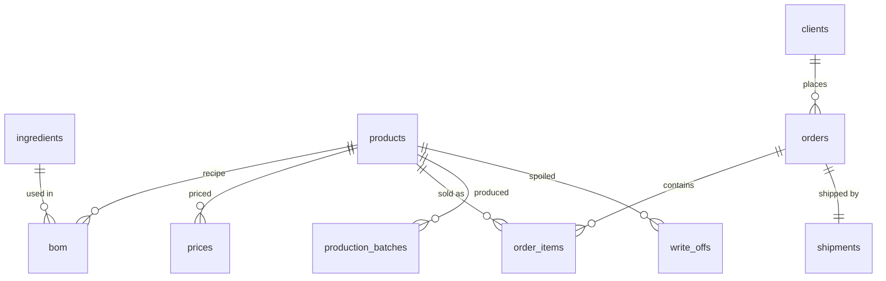
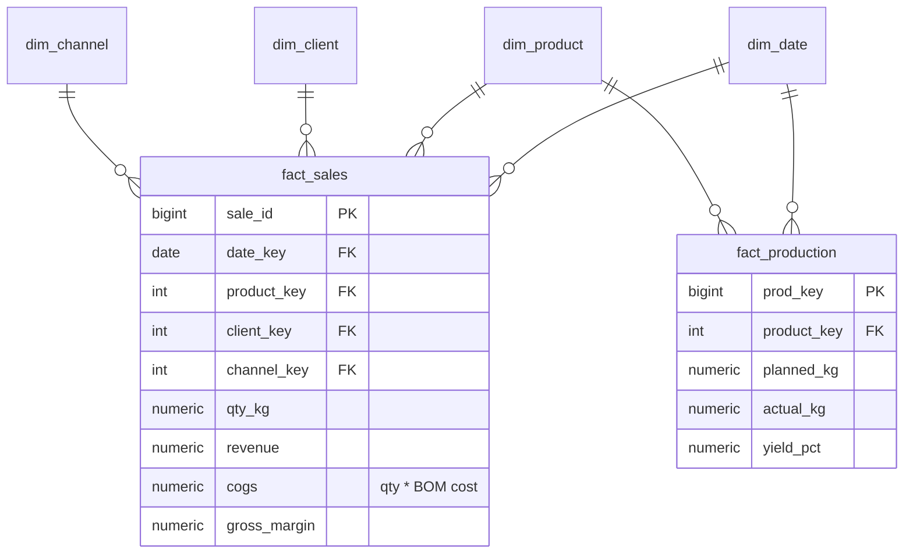

# meat-production-sql-analytics

An analytical data warehouse for a **craft meat-production business**, built and
queried **entirely in SQL** (PostgreSQL 16). It answers real management
questions — profitability, spoilage, seasonality, customer value, inventory —
from a normalized OLTP source loaded into a star schema. No pandas, no
application code in the analysis: every number comes from a hand-written query.

Three years of domain-realistic data (Sep 2023 – Aug 2026): **51 SKUs, ~300 B2B
clients, ~71k order lines, ~9k production batches**, plus price history, bill of
materials, and write-offs. The data is synthetic and **reproducible from a
fixed seed** — the generator and its assumptions are documented below so the
numbers can be trusted as *representative*, not invented.

## What it demonstrates

Recursive and non-recursive **CTEs**, **window functions** (`RANK`, `NTILE`,
`LAG`, `SUM/AVG OVER` with frames), **`GROUPING SETS`/`ROLLUP`**, a **materialized
view**, a **date dimension**, and **`EXPLAIN ANALYZE` before/after indexing** —
each applied to a concrete business question, not as a demo.

## Architecture

A normalized OLTP layer (the "system of record") is transformed by SQL ETL into
a star schema tuned for analysis.

**Source (OLTP)**



**Analytical (star schema)**



`dim_product.unit_cost` is derived during ETL from the bill of materials
(`bom` × `ingredients.cost_per_unit`), so `fact_sales.cogs` and margin are real
material costs, not guesses. A materialized view `mv_monthly_sales`
pre-aggregates monthly sales for fast reporting.

## Quick start

```bash
./build.sh          # generate data + start Postgres + load everything
```

Requires Docker and Python 3 (only for the generator; `pip install -r
requirements.txt` if Faker is missing). Then:

```bash
make analyze                      # run all 7 analysis queries
make psql                         # interactive shell
docker compose exec db psql -U meat -d meat -f /sql/analysis/01_abc_xyz.sql
```

## The questions (`sql/analysis/`)

| File | Question | SQL techniques |
|------|----------|----------------|
| `01_abc_xyz.sql` | Which SKUs drive revenue, and how stable is their demand? | window running total, CV, RANK |
| `02_gross_margin.sql` | Gross margin by category × channel, with subtotals | `GROUPING SETS` |
| `03_yield_and_writeoffs.sql` | Production yield vs plan; spoilage rate | joins, aggregation, ratios |
| `04_seasonality_trend.sql` | Monthly trend, 3-month moving average, YoY, seasonal index | `AVG OVER` frame, `LAG(12)` |
| `05_rfm_and_cohorts.sql` | Client RFM segments; cohort retention | `NTILE`, **recursive CTE** |
| `06_inventory_turnover.sql` | Turnover and days of supply per SKU | running-balance window |
| `07_pareto_clients.sql` | What share of clients make 80% of revenue? | window cumulative share |

## Key findings (real numbers from the dataset)

Full write-up in [`reports/findings.md`](reports/findings.md).

- **Revenue ₴596 M over 3 years at 71.9% gross margin;** distributors drive 77%
  of it — concentration risk sits in the channel mix.
- **32 of 51 SKUs generate ~80% of revenue** (ABC A-class). The stable
  high-value dry-cured lines are the ones to never run out of.
- **Margin ranges 88.9% (aged deli) → 54.3% (boiled sausage)** and barely moves
  by channel — profitability is a product-mix lever, not a channel one.
- **Spoilage follows shelf life:** 7.3% write-offs on pate / 6.3% on grill vs
  ~1% on salami and deli; average yield 94.2%.
- **December sells ~2× January** (seasonal index 136 vs 66) — plan production
  and cash around it.
- **17.5% of clients generate 80% of revenue;** 69 "Champions" = 74% of it, and
  7 high-value clients have gone dormant ~481 days (a win-back list). Cohort
  retention falls to ~82% by month 12.
- **Cash is tied up in slow premium stock:** fast movers turn 20–28×/year,
  premium deli only ~5×/year (~68 days of supply).

## Performance: EXPLAIN ANALYZE before/after

Two representative queries show the planner switching from a full **Seq Scan**
to a **Bitmap Index Scan** once the fact-table index is added — the
client-filter query drops from **~7.8 ms to ~0.4 ms (~18×)**. Full plans in
[`reports/explain/`](reports/explain).

## Project structure

```
data/
  generate.py          synthetic data generator (Faker, seeded)
  csv_sample/          small committed sample of each table
sql/
  ddl/  01_oltp_schema.sql  02_star_schema.sql  03_indexes.sql
  etl/  01_load_csv.sql     02_build_star.sql
  analysis/  01..07 — one business question per file, commented
reports/
  findings.md          the write-up above, in full
  explain/             EXPLAIN ANALYZE before/after
docker/initdb.sh       builds the warehouse on first container start
docker-compose.yml  build.sh  Makefile
```

## About the data (honesty note)

The dataset is **synthetic**, generated by `data/generate.py` with a fixed seed,
so anyone can rebuild the exact numbers. The distributions are chosen to be
*realistic*, and are documented in the generator's header: December-peaked
seasonality, 92–98% production yield with occasional bad batches, write-offs
that scale inversely with shelf life, ~12%/year price inflation, a 55/30/15
shop/HoReCa/distributor channel mix, and ~35% client churn. It represents a
plausible mid-size craft producer — not any real company's data.
